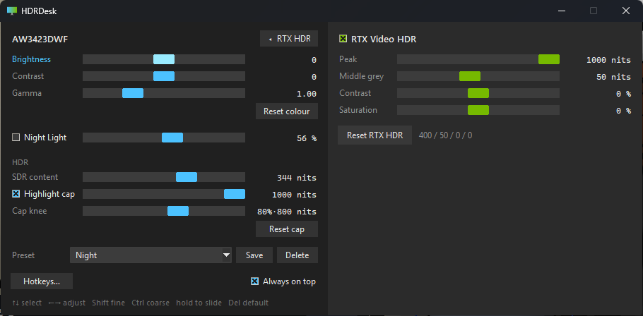

# HDRDesk

**Live display, Windows Night Light, and RTX Video HDR controls for Windows.**

Adjust desktop brightness, contrast, gamma, Windows SDR content brightness, Windows Night Light, an HDR highlight cap, and NVIDIA RTX Video HDR from one compact, keyboard-friendly window, with presets and global hotkeys. Keep the controls on top of the content you're watching and tune the image without navigating multiple settings interfaces.

**No more night-time flashbangs.** The **Highlight cap** puts a soft ceiling on how bright HDR mode is allowed to get, so a white web page opening in a dark room no longer slams your eyes, while everything below the cap looks exactly as before.



## Features

- **Desktop colour:** GPU gamma-ramp brightness, contrast and gamma, with a one-click neutral reset.
- **Windows HDR:** adjust SDR content brightness from 0–100, with the corresponding nominal SDR white level shown in nits (80–480).
- **Highlight cap (HDR):** a soft ceiling on brightness in real nits, applied to the desktop and RTX Video HDR alike. Below the knee nothing changes; above it highlights roll off smoothly towards the cap. See [Why a highlight cap?](#why-a-highlight-cap)
- **Windows Night Light:** adjust native warmth (0–100%) and switch Night Light on or off independently, preserving Windows scheduling.
- **RTX Video HDR:** enable or disable SDR-to-HDR video conversion and adjust peak brightness, middle grey, contrast and saturation live.
- **Always-on-top window:** tune against the content itself; collapse the RTX panel when not needed.
- **Presets:** save your favourite combination of settings under a name ("Night", "Gaming", "Movies"…) and switch between them from a drop-down in one click.
- **Global hotkeys:** bind a key combination to any slider, either to nudge it up or down by an amount you choose or to jump straight to a value. Works while other apps (games, videos) have focus; any combination can be used, with a heads-up for ones Windows or other apps already rely on.
- **Keyboard control:** select and adjust sliders without repeatedly reaching for the mouse.
- **State synchronization:** read the active GPU gamma ramp at startup and follow external LUT changes without overwriting them; also follow external changes to SDR white level, Windows Night Light and RTX Video HDR settings.
- **Lightweight:** Python standard library only for the main application; no administrator elevation needed for the live RTX Video HDR control path on the tested configuration.

## Why a highlight cap?

HDR on an OLED, especially a QD-OLED, looks fantastic in games. Using the desktop with it at night is a different story:

- **Flashbangs.** Go from a dark game or video to a white web page or File Explorer window and the screen jumps from pure black to blinding white in one frame. In a dark room that hurts.
- **Eyestrain.** In HDR, bright white pixels are physically far brighter than everything around them. That punch is what makes HDR games look great, but text on a white page, toolbars and dialogs are not meant to be highlights, and staring at them for hours is tiring.
- **Brightness that depends on what's on screen.** OLEDs limit how bright a mostly-white screen can be (on the tested AW3423DWF a small white patch reached about 410 nits, a full white screen only about 110), so the same white changes brightness as windows open and close.
- **Mid-whites that look off.** Watching SDR content in HDR, even through RTX Video HDR, the top of the brightness range can be stretched so that bright-but-ordinary things (white shirts, skies, UI) look either blown out or oddly flat, as if the curve were wrong.

The highlight cap fixes this at the last step before the monitor. Pick a cap in nits (say 150) and a knee where the roll-off begins: everything darker than the knee is untouched, so shadows, mid-tones and colours look exactly as before, and everything brighter eases smoothly up to the cap instead of shooting past it. Because it limits the actual signal sent to the monitor, it works the same for the desktop, browsers and RTX Video HDR, and a low enough cap also keeps the monitor's own dimming from kicking in, so white stays one steady brightness. Move the sliders against your own content to fine-tune where highlights stop, then untick it when it's time to game. The optional [test patterns](test-patterns/) (grey bars and a gradient as videos) make the effect easy to see while you tune it.

## Quick start

### Portable Windows executable (x64)

**[Download HDRDesk.exe from the latest release](../../releases/latest/download/HDRDesk.exe)** (Windows x64). See [Releases](../../releases) for versioned downloads. The [Windows build workflow](../../actions/workflows/build-windows.yml) packages the current source into a single, windowed executable; stable downloads are published separately through the release workflow. No Python installation is required for the executable. Place it in a writable folder; `settings.json` is saved alongside it. The executable is unsigned, so Windows may display a SmartScreen warning.

### Run from source

1. Download or clone the repository and keep its Python files together.
2. Install Python 3 for Windows with Tcl/Tk support (included in the standard Python installer).
3. Double-click `HDRDesk.pyw`, or run:

   ```powershell
   pythonw HDRDesk.pyw
   ```

For RTX Video HDR, enable Windows HDR on a compatible display, use a supported NVIDIA RTX GPU and driver, and open **NVIDIA App → System → Video** once if the driver registry settings have not been initialized. Use a compatible browser or video player for RTX Video HDR playback.

### Controls

| Setting | Range / behavior |
| --- | --- |
| Desktop brightness | −100 to +100 |
| Desktop contrast | −100 to +100 |
| Desktop gamma | 0.30–2.80 |
| SDR content brightness | 0–100 (nominal 80–480 nits) |
| Windows Night Light | On/off checkbox and warmth 0–100% |
| Highlight cap (HDR only) | On/off checkbox and cap 80–1000 nits (default 1000) |
| Cap knee | 50–100% of the cap (default 80%); shown with the resulting nits |
| Hotkeys… | Opens the hotkey editor: press a combination, pick a slider, choose **Nudge by** an amount or **Set to** a value; delete with Del, right-click or **Delete selected** |
| Preset | Pick a saved preset to apply it; type a name and **Save** to store the current settings; **Delete** removes the selected one |
| RTX Video HDR | On / off |
| RTX peak brightness | 400–1000 nits |
| RTX middle grey | 10–100 nits |
| RTX contrast | −100% to +100% |
| RTX saturation | −100% to +100% |

Night Light warmth and enablement are independent: 0% is the coolest setting, **not** necessarily off. The Night Light slider (between the colour controls and the HDR group) reads the current user's native Windows Night Light settings and preserves its schedule. It is available with HDR on or off. Changes made in Windows Settings are reflected automatically. If Night Light's storage is unavailable or unrecognized, HDRDesk disables these controls without creating unknown registry records. This is an **undocumented Windows CloudStore interface**. The Night Light control has passed automated codec tests and has been reported working on the Windows setup shown in the screenshot; behavior on other Windows versions and display configurations remains unverified.

Desktop brightness and contrast here are software GPU LUT adjustments, not physical monitor brightness or OSD settings. The nit values are requested/reference levels, not measurements of physical panel luminance.

**Highlight cap.** With Windows HDR on, the GPU gamma ramp acts on the PQ signal sent to the monitor, so each ramp entry corresponds to an absolute luminance. HDRDesk folds a roll-off into that ramp: luminance below the knee passes unchanged, and above it approaches (never exceeds) the cap with no visible kink. Because it sits at the end of the display path, it limits SDR desktop content and RTX Video HDR output at the same luminance. On the AW3423DWF a full-screen white field sustains only about 110 nits while small highlights reach about 400+, so a cap near that level keeps the monitor's automatic brightness limiting from kicking in and makes brightness stop depending on how much of the screen is lit. Moving the cap or knee slider switches the cap on (likewise, moving the Night Light slider switches Night Light on); **Reset cap** restores 1000 nits / 80 % (a near-neutral starting point: only highlights above 800 nits are touched) without changing the on/off state. The cap is applied together with brightness, contrast and gamma, is unavailable with HDR off, and like the other colour controls is not re-applied if Windows drops the LUT (sleep, mode change, HDR toggle): the checkbox then shows it as off. Values are relative to the PQ signal, not measured panel output.

**Hotkeys.** Click **Hotkeys…**, click the Keys box and press the combination you want (the Ctrl/Alt/Shift/Win boxes fill in automatically and can be adjusted), pick a slider, then choose **Nudge by** (an amount to add; negative to lower; gamma in decimals such as 0.05) or **Set to** (a value within the slider's range) and press **Save hotkey**. Saving a combination that already exists updates it; to delete hotkeys, select one or several in the list (Ctrl/Shift+click) and press **Del**, right-click and choose **Delete**, or use **Delete selected** under the list. Hotkeys work system-wide while HDRDesk is running, repeat while held, and are paused while the editor is open so recording a combination never triggers it. A nudge stops at the slider's limits; moving the Night Light or highlight-cap slider this way switches that feature on, as dragging it does. Controls that are unavailable at the time (for example HDR-only ones with HDR off) are skipped with a note.

Any combination can be used. When you record one that Windows or most apps already rely on (for example Alt+Tab, Win+Alt+B for the HDR toggle, Win+Ctrl+Shift+B for the graphics-driver reset, plain Win+key shortcuts, a key with no modifier, or a letter with a single modifier such as Ctrl+C), the editor shows a short heads-up about what it will override, but still lets you save it. Some combinations, such as Ctrl+Alt+Del or ones another program already owns, Windows will not hand over; HDRDesk then says the hotkey could not be registered instead of taking it over.

**Hotkey notifications.** Each hotkey press shows a small notification near the bottom of the screen with the slider's name, its new value and a position bar; repeated presses update it in place and it fades after about a second and a half. It never takes focus or blocks clicks, and it stays hidden while a fullscreen app is in front (games, fullscreen video, presentations), so it can't interrupt them. Turn it off with **Show a notification when a hotkey is used** in the hotkey editor.

**Presets.** A preset stores every control: brightness, contrast, gamma, Night Light (on/off and warmth), SDR content brightness, the highlight cap (on/off, cap and knee) and RTX Video HDR (on/off and its four sliders). To save one, type a name in the **Preset** box and press **Save** (or Enter); saving under an existing name (in any letter case) overwrites it. Pick a preset from the drop-down to apply it at once; **Delete** removes the selected preset after a confirmation. Parts that can't apply at the moment are skipped (for example SDR brightness and the cap while HDR is off, or RTX settings without a supported NVIDIA driver). Presets are stored in `settings.json`, which is written atomically whenever a preset changes.

**Reset colour** (under the colour sliders) restores neutral brightness, contrast and gamma; **Reset cap** (under the HDR group) restores the highlight-cap defaults; **Always on top** keeps the window above others. **Reset RTX HDR** restores the application's 400 / 50 / 0 / 0 baseline without changing the RTX Video HDR enable state.

### Keyboard

| Input | Action |
| --- | --- |
| Up / Down | Select previous / next slider; wraps through visible, enabled controls |
| Left / Right | Adjust by 1% of slider range |
| Shift + Left / Right | Fine adjustment of one internal unit |
| Ctrl + Left / Right | Coarse adjustment of 5% of range |
| Hold Left / Right | Repeat after 350 ms |
| Delete or double-click | Reset selected slider where a default is defined |

## Compatibility and limitations

Developed and reported tested on:

- Windows 11 with HDR enabled
- Alienware AW3423DWF
- NVIDIA GeForce RTX 3090
- NVIDIA display driver version `32.0.16.3020`

Other configurations have not been established by the supplied testing. The UI targets the primary display; independent multi-monitor control has not been implemented. Windows HDR must be enabled separately. RTX Video HDR is NVIDIA's **video** conversion feature, not RTX HDR for games.

The Windows SDR-white setter, Night Light CloudStore storage format, and NVIDIA driver-private calls are undocumented. Driver or Windows updates may change their behavior. GPU gamma-ramp effects in HDR mode also depend on the display path; this is an interactive adjustment tool, not a colorimeter calibration application.

HDRDesk reads the currently active GPU gamma ramp at launch instead of applying saved slider settings. When the ramp can be represented by HDRDesk's brightness, contrast and gamma model, the sliders display the inferred values. External LUT changes are followed rather than overwritten. If a custom LUT (such as an ICC calibration or per-channel colour curve) cannot be represented, the three values show **Unknown** and the LUT is preserved until a colour slider is adjusted. That adjustment replaces the custom LUT with HDRDesk's three-control curve. `settings.json` retains the window position, the highlight-cap settings, presets, hotkeys and an exact-match hint for ambiguous ramps; it is not an authority for the active LUT. Closing HDRDesk does not automatically restore the original display settings.

If you need to restore a neutral desktop gamma ramp, close HDRDesk and run:

```powershell
python reset.py
```

This resets the primary display's GPU gamma ramp only; it does not restore SDR brightness, RTX Video HDR or a previous custom calibration.

## How it works

| Control | Mechanism |
| --- | --- |
| Desktop brightness / contrast / gamma | GDI `SetDeviceGammaRamp` |
| Highlight cap | Same GPU ramp, built in SMPTE ST 2084 (PQ) luminance space |
| Windows SDR content brightness | Undocumented `DisplayConfigSetDeviceInfo` request, type `0xFFFFFFEE` |
| Windows Night Light | HKCU CloudStore Bond CompactBinary settings/state (undocumented) |
| RTX Video HDR | Driver-private `D3DKMTEscape` requests, reconstructed from NVIDIA App traffic |

Unlike tools that only modify RTX Video HDR registry values and depend on the driver reloading them, HDRDesk sends the driver commands directly. The driver response is checked, and the persisted registry state is read to synchronize the UI.

### RTX Video HDR internals

The driver stores settings under its NVIDIA adapter class key:

```text
HKLM\SYSTEM\CurrentControlSet\Control\Class\{4d36e968-e325-11ce-bfc1-08002be10318}\00xx
```

Global values use `_User_Global_VAL_TrueHDR` and the `_P`, `_M`, `_C`, `_S` suffixes, with per-display copies such as `_User_SUB0_DFP1_*`. Contrast and saturation are encoded as UI value + 100. Direct registry edits did not apply live on the tested configuration.

The live path replays a captured 112-byte driver-private escape:

```text
D3DKMTEscape(type=DRIVERPRIVATE, flags=0x8)
+00 'ADVN' 0x00010002 0x70 'NV**'
+10 command 0x0100003B
+30 0x00010040
+34 setting ID
+38/+3C/+40 scope
+44 value

IDs: 0x1E enable, 0x1F contrast, 0x20 saturation,
     0x21 middle grey, 0x22 peak, 0x23 commit (257)
Scopes: (2,0,0) global, (0,1,1) per-display
Response: +14 == 1 indicates driver acceptance
```

The per-display scope is the captured scope, not a general multi-monitor targeting implementation. See `nvescape.py` and the reverse-engineering tools for details.

## Repository layout

| Path | Purpose |
| --- | --- |
| `HDRDesk.pyw` | Tkinter application |
| `displaycore.py` | Windows DisplayConfig and GPU gamma ramp |
| `rampfit.py` | Read-only inference of desktop brightness, contrast and gamma from the live LUT |
| `hdrcap.py` | PQ conversion and the highlight-cap roll-off curve |
| `presets.py` | Named preset storage with tolerant loading of `settings.json` |
| `hotkeys.py` | Combination warnings and the global hotkey listener (`RegisterHotKey`) |
| `toast.py` | Hotkey notification window and fullscreen-app detection |
| `nvescape.py` | Live RTX Video HDR driver requests |
| `nvhdr.py` | NVIDIA settings discovery, registry read and persistence-only helper |
| `nightlight.py` | Native Windows Night Light strength and on/off bridge |
| `tests/test_nightlight.py` | Mock-registry codec tests without touching real Night Light settings |
| `tests/test_rampfit.py` | Cross-platform LUT inference and custom-curve regression tests |
| `tests/test_hdrcap.py` | PQ round trip, roll-off shape and capped-ramp tests |
| `tests/test_presets.py` | Preset save/overwrite/delete and malformed-settings tests |
| `tests/test_hotkeys.py` | Combination warning and stored-hotkey validation tests |
| `reset.py` | Emergency neutral gamma-ramp reset |
| `selftest.py` | Interactive Windows system-state checks |
| `test-patterns/` | Optional grey-bar and gradient test videos for seeing the cap and RTX Video HDR (see its README) |
| `tools/` | Driver tracing, registry diagnostics and display-control probes |

The self-test changes live settings and attempts to restore SDR and RTX values and a neutral gamma ramp; run it only when such changes are acceptable.

The optional Frida tracing tools require a separate Frida installation and elevation; neither is needed to run HDRDesk. The screenshot shows the current application window with the RTX Video HDR panel open.

## Project status

Experimental Windows utility. When reporting compatibility problems, include your Windows build, NVIDIA driver version, GPU, monitor, HDR mode and which control failed.

### Night Light technical reference

HDRDesk uses the reverse-engineered [Windows Night Light CloudStore format](https://github.com/kvnxiao/win-nightlight-cli/blob/main/docs/nightlight-registry-format.md) (Windows 11, tested by the upstream research on builds 26100/26300). There is no supported public Windows API for controlling this strength slider. Registry binary edits preserve unrelated scheduling fields. Native Night Light operation was confirmed in a user test on the depicted setup; other Windows builds and display paths still need validation.
